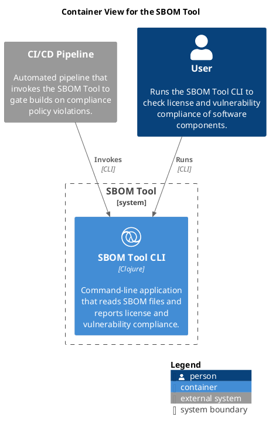

# SBOM Tool CLI (Container)
## Description
Command-line application that reads SBOM files and reports license and vulnerability compliance.

## Parent
[SBOM Tool](../sbom-tool/sbom-tool.md)

## Technology
Clojure
## Incoming Synchronous Requests 
| From | Name | To | Technology | Description |
|---|---|---|---|---|
| [CI/CD Pipeline](../sbom-tool/ci-pipeline.md) | Invokes | [SBOM Tool CLI](../sbom-tool/cli.md) | CLI |  |
| [User](../sbom-tool/user.md) | Runs | [SBOM Tool CLI](../sbom-tool/cli.md) | CLI |  |

## Container View

[Container View for the SBOM Tool](../sbom-tool/container-view.md)

## Navigation
[List of views in namespace](./views-in-namespace.md)

[List of all Views](../views.md)

(generated by [Overarch](https://github.com/soulspace-org/overarch) with template docs/node.md.cmb)
