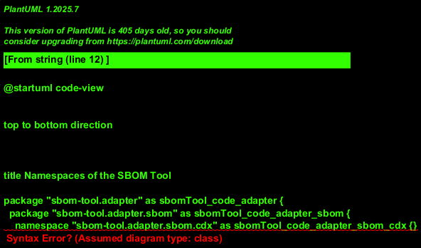

# Namespaces of the SBOM Tool

## Diagram

## Description

## Packages
| Package | Description |
|---|---|
| [sbom-tool.adapter](../sbom-tool/code/adapter.md)| Adapters for SBOM, license and VEX formats, vulnerability databases, policy files, report rendering and the CLI. |
| [sbom-tool.adapter.license](../sbom-tool/code/adapter/license.md)| License data adapters. |
| [sbom-tool.adapter.report](../sbom-tool/code/adapter/report.md)| Report rendering adapters. |
| [sbom-tool.adapter.sbom](../sbom-tool/code/adapter/sbom.md)| SBOM format adapters. |
| [sbom-tool.adapter.ui](../sbom-tool/code/adapter/ui.md)| Command-line interface. |
| [sbom-tool.adapter.vex](../sbom-tool/code/adapter/vex.md)| VEX format adapters. |
| [sbom-tool.adapter.vulnerability](../sbom-tool/code/adapter/vulnerability.md)| Optional, opt-in live vulnerability database adapters, keyed by purl. |
| [sbom-tool.application](../sbom-tool/code/application.md)| Orchestrates domain logic into use cases: the consolidated-component repository, report generation and template rendering. |
| [sbom-tool.domain](../sbom-tool/code/domain.md)| Pure domain logic: the canonical SBOM model, licenses, vulnerabilities, VEX, purls and CVSS. Depends on nothing else in the project. |

## Namespaces
| Namespace | Description |
|---|---|
| [sbom-tool.adapter.license.spdx](../sbom-tool/code/adapter/license/spdx.md)| Reads the official SPDX license list to enrich license report entries with their canonical name. |
| [sbom-tool.adapter.policies](../sbom-tool/code/adapter/policies.md)| Reads and validates license/vulnerability policy files. |
| [sbom-tool.adapter.report.json](../sbom-tool/code/adapter/report/json.md)| Renders reports as JSON. |
| [sbom-tool.adapter.report.markdown](../sbom-tool/code/adapter/report/markdown.md)| Renders reports as markdown. |
| [sbom-tool.adapter.sbom.cdx](../sbom-tool/code/adapter/sbom/cdx.md)| Reads CycloneDX SBOM files into the canonical SBOM model. |
| [sbom-tool.adapter.sbom.spdx](../sbom-tool/code/adapter/sbom/spdx.md)| Reads SPDX SBOM files into the canonical SBOM model. |
| [sbom-tool.adapter.ui.cli](../sbom-tool/code/adapter/ui/cli.md)| Command-line interface: wires adapters to the application layer and renders output. The composition root. |
| [sbom-tool.adapter.ui.errors](../sbom-tool/code/adapter/ui/errors.md)| Formats exceptions into short, human-readable CLI messages. |
| [sbom-tool.adapter.vex.openvex](../sbom-tool/code/adapter/vex/openvex.md)| Reads OpenVEX documents into the canonical VEX model. |
| [sbom-tool.adapter.vulnerability.deps-dev](../sbom-tool/code/adapter/vulnerability/deps-dev.md)| Looks up vulnerabilities in Google deps.dev. |
| [sbom-tool.adapter.vulnerability.github-advisory](../sbom-tool/code/adapter/vulnerability/github-advisory.md)| Looks up vulnerabilities in GitHub's Advisory Database. |
| [sbom-tool.adapter.vulnerability.osv](../sbom-tool/code/adapter/vulnerability/osv.md)| Looks up vulnerabilities in Google OSV. |
| [sbom-tool.application.report](../sbom-tool/code/application/report.md)| Builds the license, copyright and vulnerability reports from the repository. |
| [sbom-tool.application.repository](../sbom-tool/code/application/repository.md)| Holds consolidated components and policy/vulnerability/VEX state read by adapters. |
| [sbom-tool.application.template](../sbom-tool/code/application/template.md)| Extension point for rendering a report's data in an output format. |
| [sbom-tool.domain.component](../sbom-tool/code/domain/component.md)| Recognizes and merges components describing the same real-world package across different SBOM documents. |
| [sbom-tool.domain.cvss](../sbom-tool/code/domain/cvss.md)| Parses CVSS v2/v3 Base vector strings into severity scores and ratings. |
| [sbom-tool.domain.license](../sbom-tool/code/domain/license.md)| Evaluates and classifies component licenses against a compliance policy. |
| [sbom-tool.domain.purl](../sbom-tool/code/domain/purl.md)| Parses and renders purls (Package URLs). |
| [sbom-tool.domain.sbom](../sbom-tool/code/domain/sbom.md)| Canonical SBOM model shared by all adapters and the application layer. |
| [sbom-tool.domain.vex](../sbom-tool/code/domain/vex.md)| Domain logic for VEX statements: a supplier's per-product assertion of vulnerability exploitability. |
| [sbom-tool.domain.vulnerability](../sbom-tool/code/domain/vulnerability.md)| Evaluates and classifies component vulnerabilities against a compliance policy. |

## Navigation
[List of views in namespace](./views-in-namespace.md)

[List of all Views](../views.md)

(generated by [Overarch](https://github.com/soulspace-org/overarch) with template docs/view.md.cmb)

