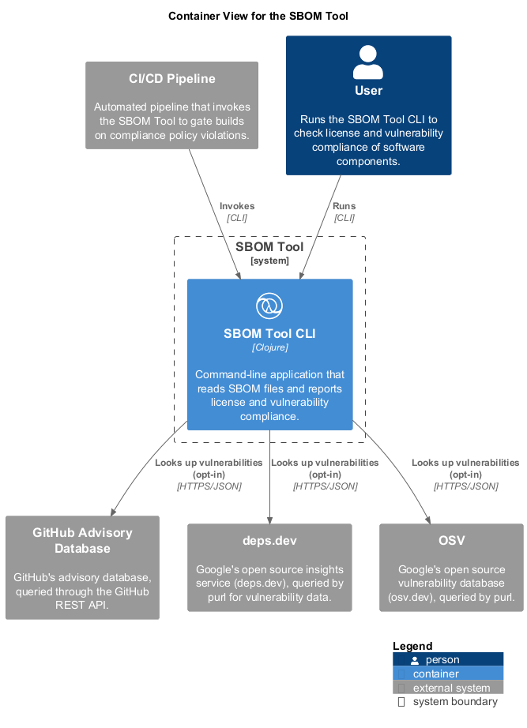

# Container View for the SBOM Tool

## Diagram

## Description
Shows the containers of the SBOM Tool and their interactions

## Roles
| Person/Role | Description |
|---|---|
| [User](../sbom-tool/user.md)| Runs the SBOM Tool CLI to check license and vulnerability compliance of software components. |

## Systems
| System | Description |
|---|---|
| [CI/CD Pipeline](../sbom-tool/ci-pipeline.md)| Automated pipeline that invokes the SBOM Tool to gate builds on compliance policy violations. |
| [GitHub Advisory Database](../sbom-tool/github-advisory.md)| GitHub's advisory database, queried through the GitHub REST API. |
| [OSV](../sbom-tool/osv.md)| Google's open source vulnerability database (osv.dev), queried by purl. |
| [SBOM Tool](../sbom-tool/sbom-tool.md)| Reads CycloneDX and SPDX software bill of materials files and reports on license and vulnerability compliance. |
| [deps.dev](../sbom-tool/deps-dev.md)| Google's open source insights service (deps.dev), queried by purl for vulnerability data. |

## Containers
| Container | Description |
|---|---|
| [SBOM Tool CLI](../sbom-tool/cli.md)| Command-line application that reads SBOM files and reports license and vulnerability compliance. |

## Synchronous Requests
| From | Name | To | Technology | Description |
|---|---|---|---|---|
| [CI/CD Pipeline](../sbom-tool/ci-pipeline.md) | Invokes | [SBOM Tool CLI](../sbom-tool/cli.md) | CLI |  |
| [SBOM Tool CLI](../sbom-tool/cli.md) | Looks up vulnerabilities (opt-in) | [GitHub Advisory Database](../sbom-tool/github-advisory.md) | HTTPS/JSON |  |
| [SBOM Tool CLI](../sbom-tool/cli.md) | Looks up vulnerabilities (opt-in) | [deps.dev](../sbom-tool/deps-dev.md) | HTTPS/JSON |  |
| [SBOM Tool CLI](../sbom-tool/cli.md) | Looks up vulnerabilities (opt-in) | [OSV](../sbom-tool/osv.md) | HTTPS/JSON |  |
| [User](../sbom-tool/user.md) | Runs | [SBOM Tool CLI](../sbom-tool/cli.md) | CLI |  |

## Navigation
[List of views in namespace](./views-in-namespace.md)

[List of all Views](../views.md)

(generated by [Overarch](https://github.com/soulspace-org/overarch) with template docs/view.md.cmb)

