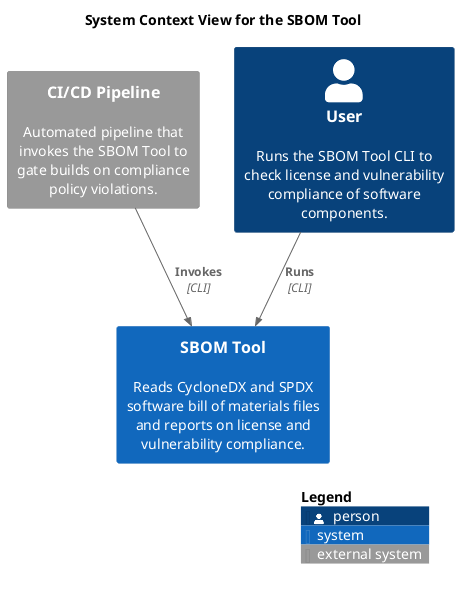

# SBOM Tool (System)
## Description
Reads CycloneDX and SPDX software bill of materials files and reports on license and vulnerability compliance.

## Implementing Decisions
| Decision | Description |
|---|---|
| [implement in Clojure](../sbom-tool/decision/implement-in-clojure.md) | The tool is implemented in Clojure (currently 1.12.5, see project.clj). |
| [support uberjar and Babashka execution](../sbom-tool/decision/multi-runtime-support.md) | Beyond `lein run`, the tool also runs as a prebuilt uberjar and as a Babashka script (bb.edn), so it can be used without a Leiningen installation (see README.md). |
| [use Leiningen as the build tool](../sbom-tool/decision/leiningen-build.md) | Leiningen (project.clj) manages dependencies, runs tests and produces the uberjar. |
## Containers
| Container | Description |
|---|---|
| [SBOM Tool CLI](../sbom-tool/cli.md) | Command-line application that reads SBOM files and reports license and vulnerability compliance. |
## Incoming Synchronous Requests 
| From | Name | To | Technology | Description |
|---|---|---|---|---|
| [CI/CD Pipeline](../sbom-tool/ci-pipeline.md) | Invokes | [SBOM Tool](../sbom-tool/sbom-tool.md) | CLI |  |
| [User](../sbom-tool/user.md) | Runs | [SBOM Tool](../sbom-tool/sbom-tool.md) | CLI |  |

## System Context View

[System Context View for the SBOM Tool](../sbom-tool/context-view.md)

## Navigation
[List of views in namespace](./views-in-namespace.md)

[List of all Views](../views.md)

(generated by [Overarch](https://github.com/soulspace-org/overarch) with template docs/node.md.cmb)
