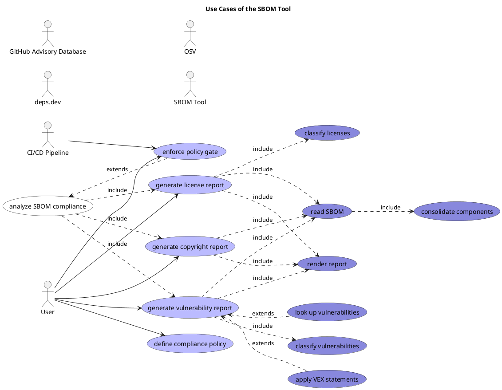
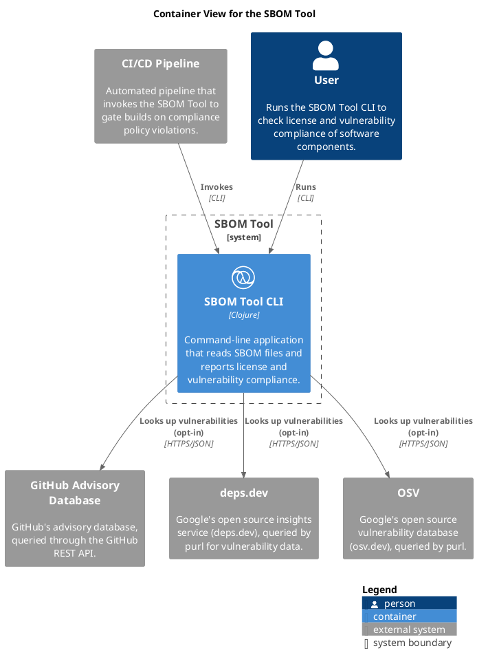

# Architecture Documentation for SBOM Tool
Reads CycloneDX and SPDX software bill of materials files and reports on license and vulnerability compliance.

## Table of Content
1. [Introduction and Goals](#introduction-and-goals)
1. [Architecture Constraints](#architecture-constraints)
1. [System Context and Scope](#system-context-and-scope)
1. [Solution Strategy](#solution-strategy)
1. [Building Block View](#building-blocks)
1. [Runtime View](#runtime-view)
1. [Deployment View](#deployment-view)
1. [Crosscutting Concepts](#crosscutting-concepts)
1. [Architectural Decisions](#architecture-decisions)
1. [Quality Requirements](#quality-requirements)
1. [Risk and Technical Debt](#risk-and-technical-debt)

## Introduction and Goals
<!-- PA-BEGIN(Introduction1) -->
<!-- PA-END(Introduction1) -->

### Goals
| Goal | Description |
|---|---|
| [CI/CD policy gate](../sbom-tool/goal/ci-gate.md) | Let a pipeline fail the build on policy violations via a dedicated exit code, distinct from usage and runtime errors. |
| [VEX-based suppression](../sbom-tool/goal/vex-suppression.md) | Apply suppliers' OpenVEX statements to downgrade or annotate vulnerabilities assessed as not affected or fixed, without changing any other component's report. |
| [canonical SBOM model](../sbom-tool/goal/canonical-sbom-model.md) | Define a single canonical SBOM model so format-specific adapters (CycloneDX, SPDX, ...) can be added without changing reporting logic. |
| [configurable compliance policy](../sbom-tool/goal/configurable-policy.md) | Make license and vulnerability policies (whitelist/blacklist, severity gates, exemptions) configurable via policy files instead of hardcoded. |
| [copyright reporting](../sbom-tool/goal/copyright-reporting.md) | Report resolved copyright notices per component and flag components with missing copyright. |
| [cross-document consolidation](../sbom-tool/goal/consolidate-components.md) | Merge components describing the same package across multiple SBOM documents (matched by purl, falling back to cpe) into one consolidated view. |
| [license reporting](../sbom-tool/goal/license-reporting.md) | Report the set of licenses in the SBOMs, licenses per component, and usage of blacklisted or greylisted licenses. |
| [live vulnerability lookups](../sbom-tool/goal/live-vulnerability-lookup.md) | Optionally enrich SBOM-embedded vulnerability data with live lookups against deps.dev, GitHub Advisory Database or OSV, keyed by component purl. |
| [multi-format SBOM input](../sbom-tool/goal/multi-format-input.md) | Read CycloneDX 1.6 and SPDX 2.2/2.3 SBOM files, with room to add further formats and versions. |
| [multi-format report output](../sbom-tool/goal/multi-format-output.md) | Render any report as EDN, JSON or Markdown, for both tooling and human consumption (e.g. PR summaries). |
| [vulnerability reporting](../sbom-tool/goal/vulnerability-reporting.md) | Report known vulnerabilities per component, from SBOM-embedded data and optional live lookups. |

### Non Goals
| Non-goal | Description |
|---|---|
| [no CVSS Temporal/Environmental scoring](../sbom-tool/goal/no-cvss-temporal-environmental.md) | CVSS vector parsing and scoring covers Base metrics only; Temporal, Environmental and Supplemental metrics are parsed and ignored, never scored. |
| [no cross-run caching](../sbom-tool/goal/no-cross-run-caching.md) | Each invocation is a one-shot, stateless analysis; de-duplication of lookups happens only within a single run, not cached across separate CLI invocations. |
| [no guessed identity merging](../sbom-tool/goal/no-automatic-unidentified-merge.md) | Components carrying neither a purl nor a cpe are never merged across documents by default, since name/version-only matching can wrongly combine unrelated packages; merging them is an explicit opt-in. |
| [no vulnerability research](../sbom-tool/goal/no-vulnerability-discovery.md) | The tool only surfaces vulnerabilities already published in the SBOM or in its configured lookup sources; it performs no vulnerability research of its own. |
| [not a source/binary scanner](../sbom-tool/goal/not-source-scanner.md) | The tool consumes pre-generated SBOM files; it does not analyze source trees, build artifacts or container images to produce an SBOM itself. |
| [not an SBOM generator](../sbom-tool/goal/not-sbom-generator.md) | The tool only reads and reports on existing SBOM files; it does not create, merge or write out a modified SBOM document. |
| [not the sole vulnerability measure](../sbom-tool/goal/not-sole-vulnerability-measure.md) | The SBOM Tool should not be treated as the only measure for vulnerability checks -- it only reports what the SBOMs and optional lookups contain, never a substitute for dedicated scanning. |

<!-- PA-BEGIN(Introduction2) -->
<!-- PA-END(Introduction2) -->

## Architecture Constraints
<!-- PA-BEGIN(ArchitectureConstraints1) -->
<!-- PA-END(ArchitectureConstraints1) -->

### Constraints
| Constraint | Description |
|---|---|
| [Eclipse Public License 1.0](../sbom-tool/constraint/epl-license.md) | The project is licensed under the Eclipse Public License 1.0 (EPL-1.0, see LICENSE); included dependencies must be compatible with it. |
| [mandated input standards](../sbom-tool/constraint/mandated-input-standards.md) | CycloneDX 1.6 and SPDX 2.2 are the mandated baseline SBOM formats/versions the tool must support, independent of which further formats are added. |
| [sbom-tool namespace prefix](../sbom-tool/constraint/namespace-prefix-convention.md) | Every project namespace is prefixed with `sbom-tool`. |

<!-- PA-BEGIN(ArchitectureConstraints2) -->
<!-- PA-END(ArchitectureConstraints2) -->

## System Context and Scope
<!-- PA-BEGIN(SystemContext1) -->
<!-- PA-END(SystemContext1) -->

### System Context View

[System Context View for the SBOM Tool](../sbom-tool/context-view.md)

<!-- PA-BEGIN(SystemContext2) -->
<!-- PA-END(SystemContext2) -->

### Scope
<!-- PA-BEGIN(Scope1) -->
<!-- PA-END(Scope1) -->

### Use Case View

[Use Cases of the SBOM Tool](../sbom-tool/use-case-view.md)

<!-- PA-BEGIN(Scope2) -->
<!-- PA-END(Scope2) -->

## Solution Strategy
<!-- PA-BEGIN(SolutionStrategy1) -->
<!-- PA-END(SolutionStrategy1) -->

### Decisions
| Decision | Description |
|---|---|
| [adopt Clean Architecture layering](../sbom-tool/decision/clean-architecture-layering.md) | The codebase is structured as domain/application/adapter layers (src/sbom_tool/domain, application, adapter, see AGENTS.md), keeping SBOM-format and I/O concerns in adapters, independent of the core logic. |
| [implement in Clojure](../sbom-tool/decision/implement-in-clojure.md) | The tool is implemented in Clojure (currently 1.12.5, see project.clj). |
| [let a license review resolve open cases but never override the blacklist](../sbom-tool/decision/reviewed-never-overrides-blacklist.md) | A reviewed component overrides grey, unidentified and no-license statuses only; blacklisted and whitelisted results stay as computed, and proprietary, reviewed or no-license components never affect the exit status. |
| [make live vulnerability lookup opt-in and fail-soft](../sbom-tool/decision/opt-in-fail-soft-live-lookup.md) | The tool runs fully offline unless a vulnerability source is selected; a failed lookup warns on stderr and yields no additional vulnerabilities instead of aborting the run. |
| [normalize SBOM formats into one canonical model](../sbom-tool/decision/canonical-sbom-model.md) | Format-specific adapters (CycloneDX, SPDX) must parse into one canonical SBOM model (AGENTS.md), so reporting and policy logic is written once, independent of the input format. |
| [resolve conflicting VEX statements to the most conservative status](../sbom-tool/decision/vex-most-conservative-status-wins.md) | VEX statements are applied only via an explicit --vex-path; when several match, affected beats under-investigation beats fixed beats not-affected, so a stale not-affected claim cannot hide an affected one. |
| [separate exit codes per failure category](../sbom-tool/decision/separate-exit-codes-per-failure-category.md) | Split the CLI's exit code for usage errors from the one for --fail-on-violations policy violations, which previously both exited 1; usage errors, policy violations and runtime/data errors now each have their own code (0/1/2/3, see dev/plans/cli-error-codes.md), forming a stable contract for CI/CD consumers. |
| [share the adapters' HTTP infrastructure in adapter.http and general helpers in util](../sbom-tool/decision/shared-adapter-support.md) | The osv, deps-dev and github-advisory adapters share one HTTP namespace (adapter.http) and general helpers in the util folder for key reading, bounded concurrency and warnings. |
| [support uberjar and Babashka execution](../sbom-tool/decision/multi-runtime-support.md) | Beyond `lein run`, the tool also runs as a prebuilt uberjar and as a Babashka script (bb.edn), so it can be used without a Leiningen installation (see README.md). |
| [use Leiningen as the build tool](../sbom-tool/decision/leiningen-build.md) | Leiningen (project.clj) manages dependencies, runs tests and produces the uberjar. |

<!-- PA-BEGIN(SolutionStrategy2) -->
<!-- PA-END(SolutionStrategy2) -->

## Building Blocks
<!-- PA-BEGIN(BuildingBlocks1) -->
<!-- PA-END(BuildingBlocks1) -->

### Container View

[Container View for the SBOM Tool](../sbom-tool/container-view.md)

<!-- PA-BEGIN(BuildingBlocks2) -->
<!-- PA-END(BuildingBlocks2) -->

## Runtime View
<!-- PA-BEGIN(RuntimeView1) -->
<!-- PA-END(RuntimeView1) -->

<!-- PA-BEGIN(RuntimeView2) -->
<!-- PA-END(RuntimeView2) -->

## Deployment View
<!-- PA-BEGIN(DeploymentView1) -->
<!-- PA-END(DeploymentView1) -->

<!-- PA-BEGIN(DeploymentView2) -->
<!-- PA-END(DeploymentView2) -->

## Crosscutting Concepts
<!-- PA-BEGIN(CrosscuttingConcepts1) -->
<!-- PA-END(CrosscuttingConcepts1) -->

### Concepts
| Decision | Description |
|---|---|
| [configure through CLI options and EDN files, and keep API keys out of the command line](../sbom-tool/decision/configuration-and-secrets-handling.md) | Behavior is set by CLI options and EDN policy files validated with clojure.spec, with bundled defaults; API keys come from an EDN file or an environment variable, never from an option value. |
| [fail loudly on user-supplied inputs, degrade gracefully on remote lookups](../sbom-tool/decision/failure-policy-by-input-kind.md) | A file the user names explicitly (SBOM, policy, VEX, SPDX list, key file) that is missing or malformed aborts the run; a failed remote lookup or an empty input directory only warns. |
| [keep provenance and report disagreements instead of silently resolving them](../sbom-tool/decision/provenance-and-conflict-reporting.md) | Merged components keep their sources and a :conflicts map where source documents disagree, and every report carries it; each vulnerability keeps its own source. |
| [report failures as typed exceptions rendered by one CLI formatter](../sbom-tool/decision/typed-exceptions-with-friendly-messages.md) | Adapters and the core throw ex-info with an :sbom-tool/error-type; the CLI turns each type into a short message and an exit code, and --debug adds the full cause chain. |
| [run remote lookups with bounded concurrency, batching and per-run deduplication](../sbom-tool/decision/bounded-concurrent-lookups.md) | Vulnerability adapters resolve each distinct identifier at most once per run, batch where the API allows, and run requests on a fixed-size thread pool. |
| [write reports to stdout and all diagnostics to stderr, without a logging library](../sbom-tool/decision/diagnostics-on-stderr.md) | Warnings and error messages go to *err* as plain 'Warning: ...' lines from small per-adapter helpers; stdout carries only the report. |

<!-- PA-BEGIN(CrosscuttingConcepts2) -->
<!-- PA-END(CrosscuttingConcepts2) -->

## Architecture Decisions
<!-- PA-BEGIN(ArchitectureDecisions1) -->
<!-- PA-END(ArchitectureDecisions1) -->

### Decisions
| Decision | Description |
|---|---|
| [extend input and output formats through multimethod extension points](../sbom-tool/decision/multimethod-extension-points.md) | The application layer defines multimethods (repository/read-sboms, read-policies, read-vulnerability-sources, template/render); adapters register formats and sources with defmethod, so the core knows neither formats nor I/O. |
| [implement purl and CVSS parsing once in the domain, without a library](../sbom-tool/decision/shared-domain-parsers.md) | Package URL parsing and CVSS v2/v3 base scoring are small hand-written domain namespaces shared by all vulnerability adapters, not private copies per adapter or a third-party dependency. |
| [keep live-lookup vulnerabilities outside the SBOM documents, keyed by purl](../sbom-tool/decision/external-vulnerabilities-by-identifier.md) | Vulnerabilities from live lookups are stored in the repository state (:external-vulnerabilities, purl to canonical vulnerability records) and merged per component, not injected into a synthetic SBOM document. |

<!-- PA-BEGIN(ArchitectureDecisions2) -->
<!-- PA-END(ArchitectureDecisions2) -->

## Quality Requirements
<!-- PA-BEGIN(QualityRequirements1) -->
<!-- PA-END(QualityRequirements1) -->

### Requirements
| Requirement | Description |
|---|---|
| [actionable error messages and diagnostics](../sbom-tool/requirement/actionable-diagnostics.md) | Errors name the failing input and the cause; --debug gives details for diagnosis, and stdout stays clean for reports. |
| [bounded load on external services](../sbom-tool/requirement/bounded-lookup-load.md) | Live lookups use batching and a fixed number of concurrent requests. |
| [configurable policies](../sbom-tool/requirement/configurable-policies.md) | License and vulnerability policies are set in a policy file, not in code. |
| [credentials are sent only to their own service](../sbom-tool/requirement/credentials-only-to-own-service.md) | An API key is sent only to the host of the service it belongs to, over HTTPS, and is never printed or logged. |
| [extensible formats and sources](../sbom-tool/requirement/extensible-formats-and-sources.md) | SBOM formats, policy formats, report formats and vulnerability sources can be added without changing the core. |
| [lookup failures do not abort the run](../sbom-tool/requirement/fault-tolerant-lookups.md) | A failed live lookup is reported as a warning and the remaining results are still produced. |
| [network calls are bounded in time and size](../sbom-tool/requirement/bounded-network-calls.md) | Every live lookup request has a connect and request timeout and a response size cap, and a timeout counts as a failed lookup. |
| [offline by default](../sbom-tool/requirement/offline-by-default.md) | The tool makes no network calls unless a live vulnerability source is explicitly selected. |
| [offline, fast and deterministic test suite](../sbom-tool/requirement/offline-deterministic-tests.md) | bb test needs no network access and gives the same result on every run. |
| [predictable report ordering](../sbom-tool/requirement/predictable-report-order.md) | Reports list vulnerabilities by severity and license counts in a defined order. |
| [pure, I/O-free domain core](../sbom-tool/requirement/pure-domain-core.md) | Domain and application code know neither SBOM formats nor I/O, and dependencies point inward. |
| [report output is safe to render](../sbom-tool/requirement/safe-report-output.md) | Untrusted text in reports is escaped for the output format, and only http(s) URLs become links. |
| [runs on the JVM and under babashka](../sbom-tool/requirement/jvm-and-babashka-portability.md) | Source namespaces load and run identically as an uberjar on the JVM and under babashka. |
| [stable, distinct exit codes](../sbom-tool/requirement/stable-exit-codes.md) | The process exit code tells success, policy violation, runtime error and usage error apart. |
| [untrusted input is handled as data](../sbom-tool/requirement/untrusted-input-as-data.md) | SBOM, VEX and policy files are parsed as data and never evaluated. |

<!-- PA-BEGIN(QualityRequirements2) -->
<!-- PA-END(QualityRequirements2) -->

## Risk and Technical Debt
### Risks
<!-- PA-BEGIN(Risk1) -->
<!-- PA-END(Risk1) -->

| Risk | Description |
|---|---|
| [CVSS v4 vectors are not scored](../sbom-tool/risk/cvss-v4-not-scored.md) | Only CVSS v2 and v3 are parsed, so findings that carry only a v4 vector rate as :unknown. |
| [VEX conflict resolution may be too coarse](../sbom-tool/risk/vex-conflict-precedence-coarse.md) | The most conservative status always wins, so a supplier's later, corrected not-affected statement can never override an older affected one. |
| [assumptions about external APIs are unverified](../sbom-tool/risk/unverified-external-api-assumptions.md) | The OSV API-key header and the GitHub 'affects' version filtering rest on guesses recorded in the plans. |
| [failed vulnerability lookup is indistinguishable from no findings](../sbom-tool/risk/failed-lookup-looks-like-clean-result.md) | A failed live lookup only warns on stderr and yields no vulnerabilities, so --fail-on-violations can pass on incomplete data. |
| [rate limits and network environments of external services](../sbom-tool/risk/external-service-limits.md) | Rate limits, throttling and restricted networks can slow or break live lookups on large SBOMs or in CI. |
| [real network calls are not covered by the automated tests](../sbom-tool/risk/network-paths-untested.md) | The vulnerability adapters' HTTP calls are deliberately not exercised by bb test, so API changes surface only in real use. |
| [untrusted text reaches markdown reports unsanitized](../sbom-tool/risk/unsanitized-markdown-output.md) | Component names, license names/URLs and advisory text from SBOMs and APIs are written into markdown with only | and newlines escaped. |

<!-- PA-BEGIN(Risk2) -->
<!-- PA-END(Risk2) -->

### Technical Debt
<!-- PA-BEGIN(TechnicalDebt1) -->
<!-- PA-END(TechnicalDebt1) -->

| Risk | Description |
|---|---|
| [SBOM adapters print their warnings inline](../sbom-tool/risk/duplicated-warn-helpers.md) | The cdx and spdx adapters print 'Warning: ...' to stderr inline instead of using the shared util.functions/warn. |
| [SPDX license list not used as the source of truth](../sbom-tool/risk/spdx-license-list-underused.md) | Identifiability is decided by a LicenseRef- prefix heuristic, and the list's deprecated flag is read but not reported. |
| [application state is one global atom](../sbom-tool/risk/global-mutable-state.md) | repository/state is a single atom that adapters fill and every report function reads implicitly, which hides data flow and blocks library use. |

<!-- PA-BEGIN(TechnicalDebt2) -->
<!-- PA-END(TechnicalDebt2) -->

(generated by [Overarch](https://github.com/soulspace-org/overarch) with template docs/arc42.md.cmb)
