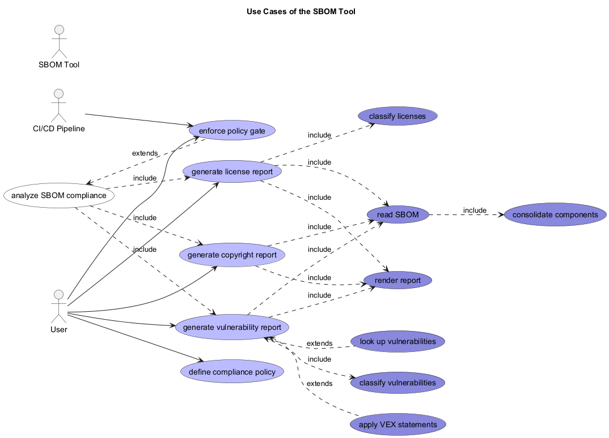

# Use Cases of the SBOM Tool

## Diagram

## Description

## Roles
| Person/Role | Description |
|---|---|
| [User](../sbom-tool/user.md)| Runs the SBOM Tool CLI to check license and vulnerability compliance of software components. |

## Use Cases
| Use Case | Description |
|---|---|
| [analyze SBOM compliance](../sbom-tool/usecase/analyze-sbom-compliance.md)| Check the licenses and known vulnerabilities of the components in one or more SBOMs against compliance policies. |
| [apply VEX statements](../sbom-tool/usecase/apply-vex-statements.md)| Apply OpenVEX statements to downgrade or annotate vulnerabilities found not affected or already fixed. |
| [classify licenses](../sbom-tool/usecase/classify-licenses.md)| Classify each component license as whitelisted, blacklisted or grey-listed per the license policy. |
| [classify vulnerabilities](../sbom-tool/usecase/classify-vulnerabilities.md)| Classify each vulnerability as ok, blocked, accepted or not affected per the vulnerability policy. |
| [consolidate components](../sbom-tool/usecase/consolidate-components.md)| Merge components describing the same package across multiple SBOM files by package URL. |
| [define compliance policy](../sbom-tool/usecase/define-compliance-policy.md)| Define license and vulnerability policy files: whitelists/blacklists, severity gates and exemptions. |
| [enforce policy gate](../sbom-tool/usecase/enforce-policy-gate.md)| Fail the process when a policy violation is found, so a build pipeline can block on non-compliant components. |
| [generate copyright report](../sbom-tool/usecase/generate-copyright-report.md)| Report on resolved copyright notices per component and components with missing copyright. |
| [generate license report](../sbom-tool/usecase/generate-license-report.md)| Report on component licenses: per-component status, summaries, multi-licensed, unidentified and blacklisted licenses. |
| [generate vulnerability report](../sbom-tool/usecase/generate-vulnerability-report.md)| Report on known vulnerabilities per component, including summaries and policy-blocked vulnerabilities. |
| [look up vulnerabilities](../sbom-tool/usecase/lookup-vulnerabilities.md)| Look up known vulnerabilities for a component's package URL from deps.dev, GitHub Advisory Database or OSV. |
| [read SBOM](../sbom-tool/usecase/read-sbom.md)| Parse one or more CycloneDX or SPDX SBOM files into the canonical SBOM model. |
| [render report](../sbom-tool/usecase/render-report.md)| Render the generated report as EDN, JSON or Markdown. |

## Extends
| From | Name | To | Description |
|---|---|---|---|
| [apply VEX statements](../sbom-tool/usecase/apply-vex-statements.md) |  | [generate vulnerability report](../sbom-tool/usecase/generate-vulnerability-report.md) |  |
| [look up vulnerabilities](../sbom-tool/usecase/lookup-vulnerabilities.md) |  | [generate vulnerability report](../sbom-tool/usecase/generate-vulnerability-report.md) |  |
| [enforce policy gate](../sbom-tool/usecase/enforce-policy-gate.md) |  | [analyze SBOM compliance](../sbom-tool/usecase/analyze-sbom-compliance.md) |  |

## Uses
| From | Name | To | Description |
|---|---|---|---|
| [CI/CD Pipeline](../sbom-tool/ci-pipeline.md) |  | [enforce policy gate](../sbom-tool/usecase/enforce-policy-gate.md) |  |
| [User](../sbom-tool/user.md) |  | [define compliance policy](../sbom-tool/usecase/define-compliance-policy.md) |  |
| [User](../sbom-tool/user.md) |  | [enforce policy gate](../sbom-tool/usecase/enforce-policy-gate.md) |  |
| [User](../sbom-tool/user.md) |  | [generate license report](../sbom-tool/usecase/generate-license-report.md) |  |
| [User](../sbom-tool/user.md) |  | [generate copyright report](../sbom-tool/usecase/generate-copyright-report.md) |  |
| [User](../sbom-tool/user.md) |  | [generate vulnerability report](../sbom-tool/usecase/generate-vulnerability-report.md) |  |

## Systems
| System | Description |
|---|---|
| [CI/CD Pipeline](../sbom-tool/ci-pipeline.md)| Automated pipeline that invokes the SBOM Tool to gate builds on compliance policy violations. |
| [SBOM Tool](../sbom-tool/sbom-tool.md)| Reads CycloneDX and SPDX software bill of materials files and reports on license and vulnerability compliance. |

## Navigation
[List of views in namespace](./views-in-namespace.md)

[List of all Views](../views.md)

(generated by [Overarch](https://github.com/soulspace-org/overarch) with template docs/view.md.cmb)

